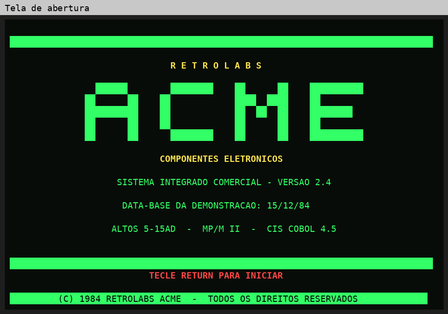

# RetroLABS ACME — Sistema Integrado Comercial (1984)

Sistema comercial completo escrito em **CIS COBOL 4.5**, rodando num microcomputador
multiusuário **Altos 5-15** com **MP/M II**, recriado pela **RetroLABS** para exposição
de retrocomputação. Ele simula uma distribuidora brasileira de componentes eletrônicos
em dezembro de 1984, com **três terminais**, cada um representando um departamento
da empresa.



| | |
|---|---|
| **Máquina** | Altos 5-15 (Zilog Z80), MP/M II, disquetes de 5¼" |
| **Linguagem** | CIS COBOL 4.5 (Micro Focus), código intermediário `.INT` executado pelo `RUNA` |
| **Terminais** | 3 terminais seriais (hoje, TeraTerm emulando VT100) |
| **Programas** | 14 módulos do sistema + 3 utilitários + 5 programas de teste |
| **Base de dados** | 12 arquivos indexados: 100 clientes, 40 fornecedores, 500 produtos, movimento de out–dez/1984 |

## Os três departamentos

| Terminal | Departamento | O que faz |
|---|---|---|
| **1** | Comercial — faturamento e vendas | Clientes, pedidos de venda, duplicatas geradas no faturamento |
| **2** | Suprimentos — compras e almoxarifado | Produtos, estoque, compras, fornecedores |
| **3** | Financeiro — contas e gerência | Contas a receber e a pagar, relatórios, auditoria |

Detalhes em [docs/03-departamentos.md](docs/03-departamentos.md).

## Estrutura do repositório

```
fontes/        os 14 programas do sistema (.CBL) e os arquivos de compilação (.SUB)
utilitarios/   carga e inicialização da base (RACLOAD, RACINIT, RACPAR)
testes/        programas de teste do terminal, do CALL e do compartilhamento
dados/         base de demonstração V9 em texto (12 arquivos .TXT) e roteiro da carga
ferramentas/   scripts Python para conferir a base no PC
docs/          documentação, telas e o painel da exposição (PDF)
```

## Documentação

1. [Contexto histórico — o Brasil de 1984](docs/01-contexto-historico.md)
2. [A plataforma — Altos 5-15, MP/M II e CIS COBOL](docs/02-plataforma.md)
3. [Os departamentos usuários](docs/03-departamentos.md)
4. [Fluxo do sistema e arquivos](docs/04-fluxo-do-sistema.md)
5. [Os programas, um a um](docs/05-programas.md)
6. [Compilação, carga e operação](docs/06-operacao.md)
7. [Histórico das versões](docs/07-historico-versoes.md)

## Início rápido (no Altos)

```
A>SUBMIT COMPILA          compila os 14 programas (gera os .INT)
A>B:RUNA A:RACLOAD.INT    carrega a base (TXT no A:, base gravada no B:)
A>RUNA RACMENU            abre o sistema
```

Os `.INT` ficam no **A:** (o menu chama `A:RACxxx.INT`) e os dados no **B:**
(`B:CLI.DAT`, `B:PROD.DAT`...). Veja [docs/06-operacao.md](docs/06-operacao.md).

## Sobre os arquivos-fonte

Os fontes estão no formato original do CP/M: ASCII puro, linhas CR/LF, Control-Z
no final e no máximo 72 colunas. O arquivo `.gitattributes` impede que o Git
altere os finais de linha. Não converta os `.CBL` para LF, ou o compilador do
CP/M deixa de lê-los corretamente.

## Créditos

Projeto, hardware e apresentação: **José Luiz Martins — RetroLABS**.
Os nomes de empresas e pessoas da base de demonstração são fictícios.
