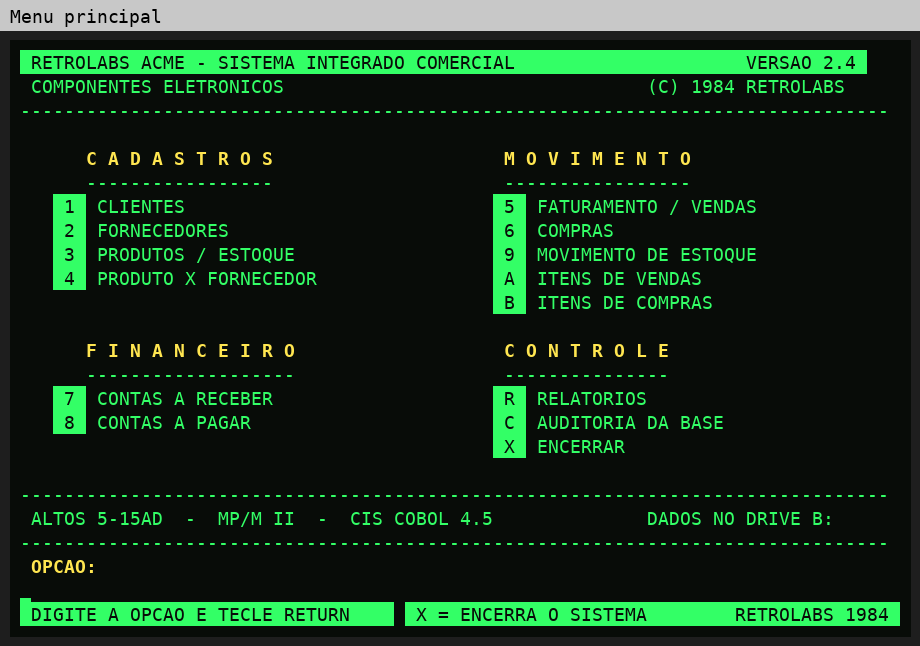

# A plataforma

## Hardware

- **Altos 5-15**: microcomputador multiusuário da Altos Computer Systems
  (Califórnia), com processador **Zilog Z80** e unidades de disquete de 5¼".
- **Terminais**: três terminais de vídeo ligados por porta serial. Na exposição,
  são PCs com o **TeraTerm** emulando um terminal VT100.
- **Impressora**: saída pelo dispositivo `LST:` do CP/M/MP/M.

## Software

- **MP/M II** (Digital Research, 1981): versão multiusuário do CP/M, que permite
  vários terminais usando o mesmo computador ao mesmo tempo.
- **CIS COBOL 4.5** (Micro Focus, 1978–1982): o compilador gera **código
  intermediário** (`.INT`), executado pelo interpretador **RUNA**. Os módulos
  são chamados pelo menu com `CALL "A:RACxxx.INT"`.

## Disquetes

Formato das imagens usadas (HFE, para emulador de drive):
80 cilindros, 2 faces, 9 setores de 512 bytes por trilha, MFM,
blocos CP/M de 4 KB e 256 entradas de diretório.

| Drive | Conteúdo |
|---|---|
| **A:** | RUNA, os 14 `.INT` do sistema e o `RACLOAD.INT` |
| **B:** | a base de dados (12 arquivos `.DAT` + 12 `.IDX`) |

## Telas

O CIS COBOL não posicionava o cursor com o terminal usado, então as telas mandam
diretamente as sequências **VT100** (ESC `[`) para limpar a tela, posicionar o
texto e usar **vídeo inverso**, **alta intensidade** e **piscante**.
Cada tela tem 24 linhas: título na linha 1, dados até a 21, pergunta na 22,
digitação na 23 e rodapé na 24.

Para ficar monocromático no TeraTerm (verde ou âmbar), veja
[06-operacao.md](06-operacao.md#cores-do-teraterm).

## O dialeto CIS COBOL 4.5

O CIS COBOL é ANSI-74 nível 1 com alguns recursos do nível 2. Estas regras foram
confirmadas compilando no próprio Altos (resumo de [`fontes/CISCOBOL.TXT`](../fontes/CISCOBOL.TXT)):

| Não existe no CIS | Use no lugar |
|---|---|
| `PERFORM ... VARYING` | `MOVE` + `PERFORM ... UNTIL` com contador |
| `COMPUTE` | `ADD`, `SUBTRACT`, `MULTIPLY`, `DIVIDE` |
| `ADD a TO b GIVING c` | `ADD a b GIVING c` |
| `AND` / `OR` em condições | `IF` aninhados |
| `EVALUATE`, `END-IF` e demais `END-` | `IF` / `ELSE` com ponto final |
| `STRING`, `UNSTRING`, `INSPECT`, `INITIALIZE`, `SEARCH` | laços com `OCCURS` |
| `ACCEPT ... FROM DATE/TIME` | data fixa da demonstração (15/12/84) |
| `ROUNDED` | truncamento |
| `GO TO ... DEPENDING ON` | sequência de `IF ... GO TO` |

Outras regras: no máximo 72 colunas; `CALL` recebe o **nome do arquivo** com
extensão (`"A:RACCLI.INT"`); no máximo 12 arquivos abertos ao mesmo tempo
(cada indexado conta 2: `.DAT` e `.IDX`); no máximo 7 programas chamados;
PERFORM aninhado até 22 níveis.

### Erros de execução encontrados durante o projeto

| Erro | Significado | Causa no projeto |
|---|---|---|
| 002 | arquivo não aberto | fechamento de arquivo não aberto (resolvido com FILE STATUS) |
| 012 | arquivo já aberto | índice danificado ou arquivo em uso |
| 157 | memória insuficiente para carregar o programa | módulos grandes demais (enxugados na V23) |
| 164 | programa chamado não encontrado | `CALL` sem extensão ou no drive errado |
