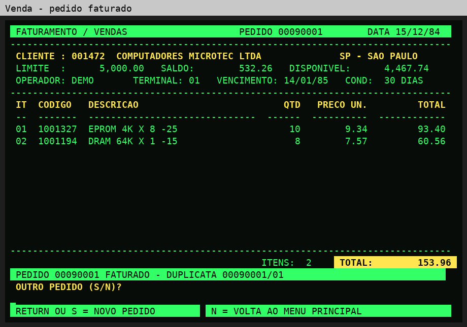
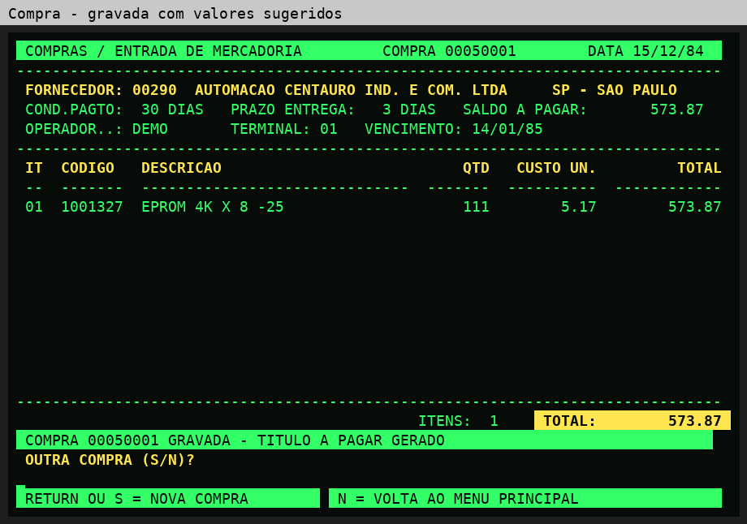
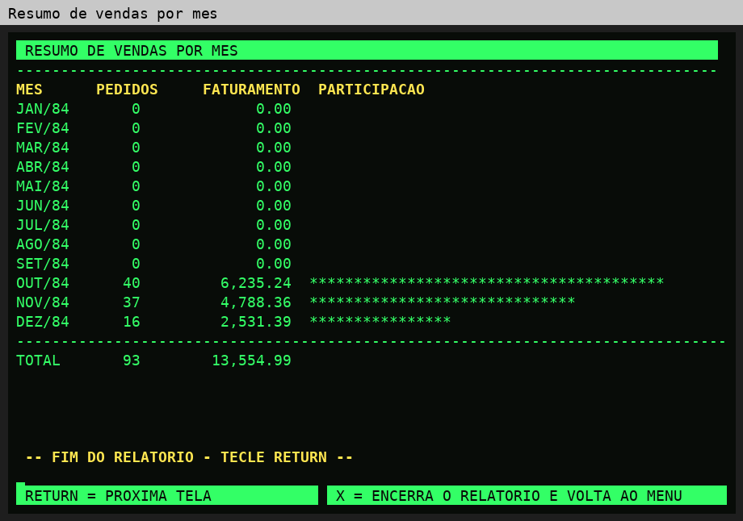

# Os departamentos usuários

A empresa fictícia **RetroLABS ACME — Componentes Eletrônicos** tem três
departamentos, e cada um usa o seu terminal ligado ao mesmo Altos 5-15.

## Terminal 1 — Comercial (faturamento e vendas)

O balcão de vendas atende o cliente, confere o limite de crédito e emite o pedido.
Quando o pedido é confirmado, o sistema de uma só vez:
baixa o estoque, registra o movimento, gera a **duplicata** a receber
e atualiza o saldo e o histórico do cliente.

| Menu | Programa | Uso |
|---|---|---|
| 1 | RACCLI | cadastro de clientes |
| 5 | RACVEN | faturamento / pedido de venda |
| A | RACIV | consulta dos itens de venda |

## Terminal 2 — Suprimentos (compras e almoxarifado)

O almoxarifado controla o estoque de cada componente, e o comprador repõe o que
chegou ao ponto de pedido. A entrada da compra atualiza o estoque, recalcula o
**custo médio** e gera o título a pagar ao fornecedor.

| Menu | Programa | Uso |
|---|---|---|
| 2 | RACFOR | cadastro de fornecedores |
| 3 | RACPRO | produtos e estoque |
| 4 | RACPF | produto × fornecedor (quem fornece cada item, a que custo) |
| 6 | RACCOM | compras / entrada de mercadoria |
| 9 | RACMOV | consulta do movimento de estoque |
| B | RACIC | consulta dos itens de compra |

## Terminal 3 — Financeiro (contas e gerência)

O financeiro recebe as duplicatas, paga os fornecedores e acompanha o resultado.
No fim do dia, a auditoria confere os totais antes da cópia dos disquetes.

| Menu | Programa | Uso |
|---|---|---|
| 7 | RACREC | contas a receber (consulta e baixa) |
| 8 | RACPAG | contas a pagar (consulta e baixa) |
| R | RACREL | 13 relatórios, no vídeo ou na impressora |
| C | RACCHK | auditoria da base |

## Uso simultâneo dos terminais

O sistema não tem controle de concorrência, e o MP/M abre os arquivos em modo
exclusivo. Módulos que usam os mesmos arquivos não podem ficar abertos ao mesmo
tempo em terminais diferentes:

| Módulo | Arquivos |
|---|---|
| Vendas | VEN, ITVEN, CLI, PROD, MOVEST + PARAM e REC na gravação |
| Compras | COMP, ITCOM, FORN, PROD, MOVEST + PARAM e PAG na gravação |
| Contas a receber | REC, CLI |
| Contas a pagar | PAG, FORN |

Na exposição, os terminais trabalham **em rodízio**: um departamento opera, e os
outros ficam na tela de abertura ou no menu, que não abre arquivos.
