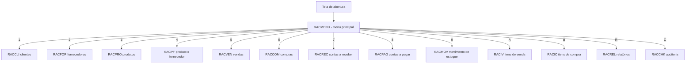
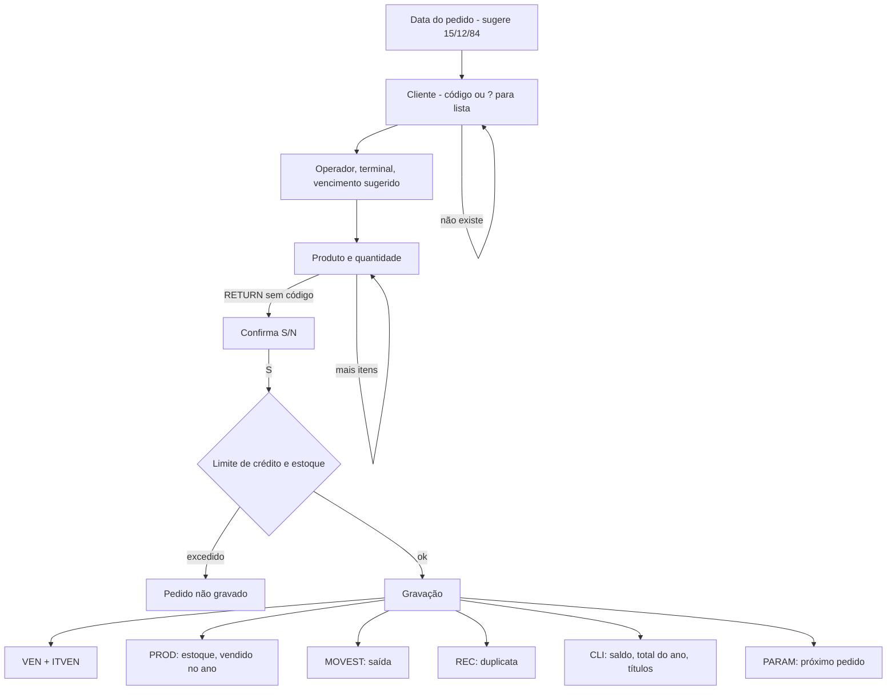
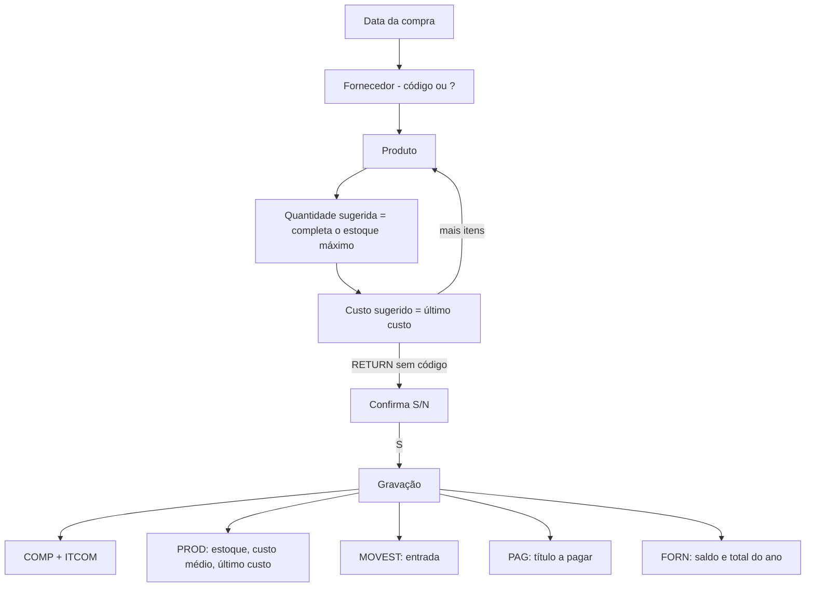
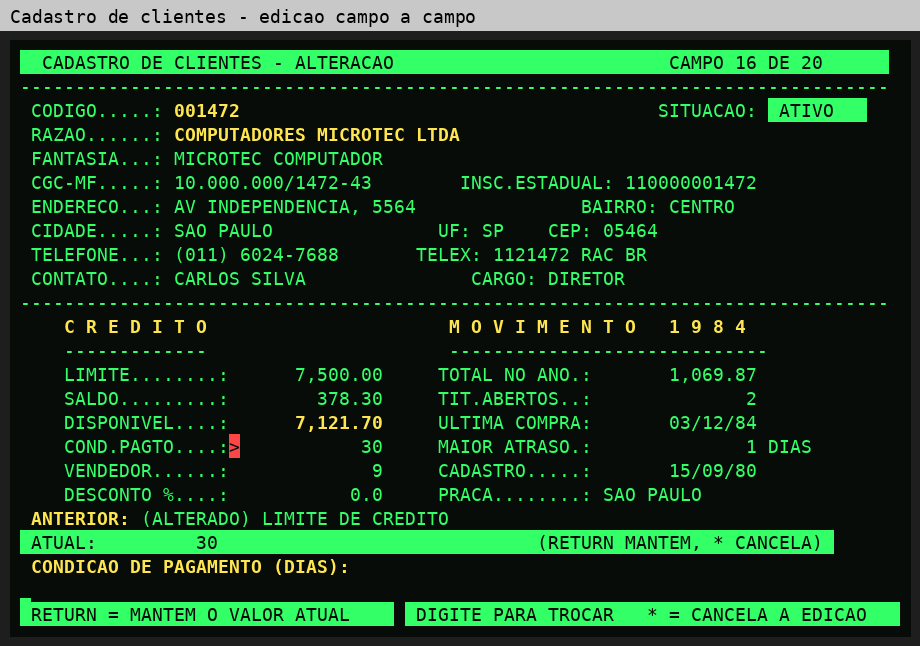

# Fluxo do sistema

## Visão geral

Cada opção faz `CALL "A:RACxxx.INT"`; ao sair do módulo com X, o menu faz
`CANCEL` e libera a memória.

## Venda (Terminal 1)

## Compra (Terminal 2)

## Baixa de títulos (Terminal 3)

O título mostrado na tela é baixado com a data do pagamento (sugerida 15/12/84).
Na baixa a receber, o saldo e a quantidade de títulos em aberto do cliente são
atualizados; na baixa a pagar, os do fornecedor.

## Arquivos

Todos são indexados (`.DAT` + `.IDX`) e ficam no drive B:.

| Arquivo | Conteúdo | Chave | Registro |
|---|---|---|---|
| CLI | clientes | código (6) | 341 bytes |
| FORN | fornecedores | código (5) | 330 bytes |
| PROD | produtos e estoque | código (7) | 188 bytes |
| PRODF | produto × fornecedor | produto (7) + fornecedor (5) | 60 bytes |
| VEN | pedidos de venda | número (8) | 77 bytes |
| ITVEN | itens de venda | pedido (8) + item (3) | 45 bytes |
| COMP | compras | número (8) | 43 bytes |
| ITCOM | itens de compra | compra (8) + item (3) | 43 bytes |
| REC | contas a receber | título (8) + parcela (2) | 102 bytes |
| PAG | contas a pagar | título (8) + parcela (2) | 65 bytes |
| MOVEST | movimento de estoque | tipo (E/S/I) + documento (8) + item (3) | 50 bytes |
| PARAM | parâmetros (próximo pedido, próxima compra) | chave (2) | 64 bytes |

## Navegação nas telas de consulta

| Tecla | Ação |
|---|---|
| `=` (ou RETURN) | próximo registro |
| `-` | registro anterior (clientes, fornecedores, títulos) |
| `I` / `F` | primeiro / último |
| código | vai direto ao registro (aceita sem zeros: `1472`) |
| `1` `3` `4` | inclui, altera (campo a campo), inativa |
| `X` | volta ao menu |

Na edição, cada campo mostra o valor atual; RETURN mantém, digitar substitui,
`*` cancela tudo, e uma confirmação S/N antecede a gravação.

